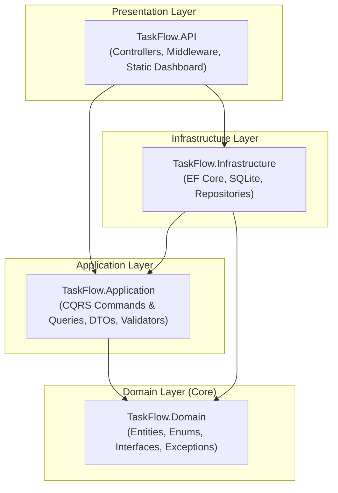

<div align="center">

# ⚡ TaskFlow

**A modern, production-ready Task Management REST API built with .NET 6 & C# following Clean Architecture principles.**

[](https://dotnet.microsoft.com/)
[](https://docs.microsoft.com/en-us/dotnet/csharp/)
[](https://docs.microsoft.com/en-us/ef/core/)
[](https://www.sqlite.org/)
[](LICENSE)

[Architecture](#-architecture) • [Features](#-features) • [Quick Start](#-quick-start) • [API Endpoints](#-api-endpoints) • [Testing](#-testing)

</div>

---

## 📖 Overview

**TaskFlow** demonstrates enterprise-grade software architecture patterns in C#. It implements Robert C. Martin's (**Uncle Bob**) **Clean Architecture**, completely decoupling business domain rules from data stores, external frameworks, and presentation layers.

Additionally, it comes with a built-in **interactive web dashboard** served directly from ASP.NET Core, alongside **Swagger/OpenAPI** interactive documentation.

---

## 🏛 Architecture

Dependencies strictly flow **inward**. Outer layers depend on inner layers; the inner Domain layer has **zero dependencies**.



### Layer Breakdown

| Layer | Project | Responsibilities |
| :--- | :--- | :--- |
| **Domain** | `TaskFlow.Domain` | Enterprise business entities, domain enums, repository contracts, and domain exceptions. Zero external packages. |
| **Application** | `TaskFlow.Application` | Business use cases via **CQRS** (MediatR), validation pipelines (FluentValidation), and DTO definitions. |
| **Infrastructure** | `TaskFlow.Infrastructure` | EF Core `DbContext`, entity type configurations (Fluent API), concrete repositories, and SQLite persistence. |
| **API** | `TaskFlow.API` | ASP.NET Core controllers, global exception middleware, Swagger/OpenAPI setup, and static dashboard host. |
| **Tests** | `TaskFlow.UnitTests` | Isolated unit tests using `xUnit`, `Moq`, and `FluentAssertions`. |

---

## ✨ Key Features

- **CQRS Pattern**: Segregated read/write pipelines using `MediatR`.
- **Validation Pipeline**: Automatic cross-cutting request validation with `FluentValidation` before reaching handlers.
- **Repository Pattern & Unit of Work**: Abstracted data access layers for testability and flexibility.
- **Global Error Handling**: Centralized middleware converting exceptions into consistent RFC-compliant JSON responses.
- **Audit Logging**: Automatic tracking of `CreatedAt` and `UpdatedAt` timestamps on all entities.
- **Database Seeding**: Default categories initialized automatically on startup.
- **Interactive UI**:
  - 🎨 Built-in Single Page Application at `/`
  - 📖 Swagger API documentation at `/swagger`

---

## 🛠 Tech Stack

- **Language:** C# 10
- **Framework:** .NET 6.0 Web API
- **Data Access:** Entity Framework Core 6.0
- **Database:** SQLite
- **Mediator & CQRS:** MediatR
- **Validation:** FluentValidation
- **API Docs:** Swashbuckle / Swagger
- **Testing:** xUnit, Moq, FluentAssertions

---

## 🚀 Quick Start

### Prerequisites
- [.NET 6.0 SDK](https://dotnet.microsoft.com/download/dotnet/6.0) or higher

### 1. Clone the Repository
```bash
git clone https://github.com/hamzaihsan9/TaskFlow.git
cd TaskFlow
```

### 2. Build the Solution
```bash
dotnet build
```

### 3. Run the Application
You can use the provided run script:
```bash
./run.sh
```

Or run via the .NET CLI:
```bash
dotnet run --project src/TaskFlow.API
```

### 4. Open in Your Browser
- **Dashboard:** [http://localhost:5000](http://localhost:5000)
- **Swagger Documentation:** [http://localhost:5000/swagger](http://localhost:5000/swagger)

---

## 📡 API Endpoints

### 📋 Tasks (`/api/tasks`)

| Method | Endpoint | Description |
| :--- | :--- | :--- |
| `GET` | `/api/tasks` | Retrieve all tasks |
| `GET` | `/api/tasks/{id}` | Retrieve details of a task by ID |
| `POST` | `/api/tasks` | Create a new task |
| `PUT` | `/api/tasks/{id}` | Update an existing task |
| `DELETE` | `/api/tasks/{id}` | Delete a task |

#### Example: Create Task Request
```http
POST /api/tasks
Content-Type: application/json

{
  "title": "Design Microservices Architecture",
  "description": "Prepare system design diagrams and service boundaries",
  "priority": "High",
  "categoryId": 1
}
```

---

### 📁 Categories (`/api/categories`)

| Method | Endpoint | Description |
| :--- | :--- | :--- |
| `GET` | `/api/categories` | Retrieve all categories with task counts |
| `GET` | `/api/categories/{id}` | Retrieve single category with associated tasks |
| `POST` | `/api/categories` | Create a new category |
| `DELETE` | `/api/categories/{id}` | Delete a category |

---

## 🧪 Testing

The solution includes automated unit tests validating command handlers, uniqueness business rules, and input validations.

Run the test suite with:
```bash
dotnet test
```

```text
Starting test execution, please wait...
A total of 1 test files matched the specified pattern.

Passed!  - Failed: 0, Passed: 8, Skipped: 0, Total: 8
```

---

## 📂 Project Structure

```
TaskFlow/
├── TaskFlow.sln
├── run.sh
├── README.md
├── src/
│   ├── TaskFlow.Domain/
│   │   ├── Common/          # BaseEntity audit fields
│   │   ├── Entities/        # TaskItem, Category
│   │   ├── Enums/           # Priority, TaskItemStatus
│   │   ├── Exceptions/      # NotFoundException, BadRequestException
│   │   └── Interfaces/      # Repository contracts
│   ├── TaskFlow.Application/
│   │   ├── Behaviors/       # MediatR validation pipeline
│   │   ├── DTOs/            # Request/Response data transfers
│   │   ├── Features/        # CQRS Commands & Queries
│   │   └── Validators/      # FluentValidation rules
│   ├── TaskFlow.Infrastructure/
│   │   ├── Persistence/     # EF Core DbContext & configurations
│   │   └── Repositories/    # Concrete EF Core implementations
│   └── TaskFlow.API/
│       ├── Controllers/     # REST API endpoints
│       ├── Middleware/      # Global exception handling
│       └── wwwroot/         # Single-page web dashboard
└── tests/
    └── TaskFlow.UnitTests/  # Unit test suite
```

---

## 📄 License

This project is licensed under the [MIT License](LICENSE).
